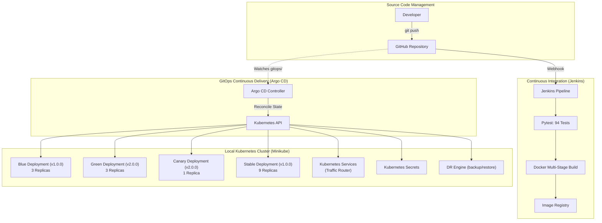

# 🚀 Enterprise DevOps Deployment Toolkit (EDDT)

[](jenkins/Jenkinsfile)
[](tests/)
[](reports/)
[](kubernetes/)
[](gitops/)

> **A complete, beginner-friendly yet enterprise-grade DevOps project demonstrating
> Automated Testing in CI/CD, Blue-Green Deployment, Canary Deployment, GitOps Delivery,
> Secure Secret Management, Disaster Recovery, and Real-Time Observability — tailored for Linux, WSL, and Minikube environments.**

---

## 1. Project Introduction & Objectives

The **Enterprise DevOps Deployment Toolkit (EDDT)** is an end-to-end laboratory and reference implementation for enterprise-grade continuous integration and continuous delivery. 

At the center of EDDT is **Enterprise TaskFlow**, a production-style Python Flask task management application backed by SQLite, equipped with health/readiness/version probes, and hardened for containerized orchestration.

### Core Objectives
1. **Automated Testing in CI/CD**: Enforce automated quality gates with Pytest, JUnit XML generation, and statement code coverage.
2. **Blue-Green Deployment**: Implement atomic, zero-downtime production cutovers and sub-second rollbacks via Kubernetes Service selector manipulation.
3. **Canary Deployment**: Execute progressive risk-mitigated rollouts with incremental replica weighting and automated health verification.
4. **GitOps Continuous Delivery**: Declare cluster state in Git as the single source of truth, automated by an in-cluster Argo CD reconciliation loop with active drift detection.
5. **Secure Secret Management**: Establish strict secret hygiene in Kubernetes, demystify Base64 encoding risks, enforce RBAC, and model external secret managers (HashiCorp Vault / ESO).
6. **Disaster Recovery & Rollback**: Implement automated SQLite hot backups, cryptographic SHA-256 verification, `PRAGMA integrity_check`, and defined RPO (< 1 hour) and RTO (< 15 minutes) targets.
7. **Deployment Monitoring & Diagnostics**: Provide diagnostic toolkits for pod lifecycles, endpoint latencies, container logs, and cluster troubleshooting.
8. **Enterprise Workflow Documentation**: Provide complete architectural blueprints, comparison matrices, and step-by-step laboratory runbooks.

---

## 2. Technology Stack

| Layer | Component | Version / Tool | Purpose in EDDT |
|:------|:----------|:---------------|:----------------|
| **Application** | Python / Flask | 3.0.3 | TaskFlow CRUD API and Web Dashboard |
| **Persistence** | SQLite 3 | Embedded | Local ACID relational persistence |
| **Testing** | Pytest & pytest-cov | 8.2+ / 5.0+ | Automated unit, API, and probe testing (94 tests, 94% coverage) |
| **Containerization**| Docker | 24+ | Multi-stage build, non-root user (1001:appuser), Gunicorn server |
| **CI Engine** | Jenkins | 2.x Declarative | 9-stage pipeline with automated test publishing and approval gates |
| **Orchestration** | Kubernetes | 1.28+ (Minikube) | Workload scheduling, Services, Probes, and Rolling updates |
| **GitOps** | Argo CD | 2.x | Declarative Git-to-cluster synchronization and self-healing |
| **Secrets** | Kubernetes Secrets | Native Opaque | Environment injection, volume mounts, and Vault extension model |
| **Disaster Recovery**| Bash & Python | Custom suite | Hot backup, integrity validation, and safe pre-restore snapshots |

---

## 3. System Architecture



---

## 4. Repository Structure

```text
enterprise-devops-toolkit/
│
├── app/                          # Enterprise TaskFlow Application
│   ├── app.py                    # Flask API and SQLite CRUD logic
│   ├── requirements.txt          # Application and testing dependencies
│   └── templates/
│       └── index.html            # Web UI dashboard
│
├── tests/                        # Automated Pytest Suite (94 Tests)
│   ├── conftest.py               # Shared test configuration & path discovery
│   ├── test_app.py               # Unit tests, DB init, validation boundaries
│   ├── test_health.py            # /health, /ready, /version probe tests
│   └── test_api.py               # Full CRUD API and filtering tests
│
├── docker/                       # Container Configurations
│   ├── Dockerfile                # Multi-stage build, non-root user 1001
│   ├── docker-compose.yml        # Local blue/green/canary multi-container setup
│   ├── .dockerignore             # Build context filter
│   └── .env.example              # Environment variables template
│
├── jenkins/                      # Continuous Integration
│   └── Jenkinsfile               # 9-stage declarative CI/CD pipeline
│
├── kubernetes/                   # Kubernetes Manifests
│   ├── blue-green/               # Blue-Green deployment & service manifests
│   │   ├── blue-deployment.yaml
│   │   ├── green-deployment.yaml
│   │   └── service.yaml
│   ├── canary/                   # Canary deployment & shared service manifests
│   │   ├── stable-deployment.yaml
│   │   ├── canary-deployment.yaml
│   │   └── service.yaml
│   └── secrets/                  # Secret management manifests & guide
│       ├── secret-example.yaml
│       └── README.md
│
├── gitops/                       # GitOps Configurations (Argo CD)
│   ├── application.yaml          # Argo CD Application Custom Resource
│   ├── README.md                 # Argo CD setup and drift correction guide
│   └── environments/             # Kustomize environment overlays
│       ├── development/
│       ├── staging/
│       └── production/
│
├── scripts/                      # Deployment Automation Scripts
│   ├── deploy-blue.sh            # Deploys blue baseline
│   ├── deploy-green.sh           # Deploys green candidate with verification gate
│   ├── rollback-blue-green.sh    # Instant rollback to blue
│   ├── deploy-canary.sh          # Deploys 90/10 canary split
│   ├── promote-canary.sh         # Progressive canary rollout workflow
│   └── rollback-canary.sh        # Instant canary decommission
│
├── disaster-recovery/            # Business Continuity Engine
│   ├── backup.sh                 # Hot SQLite backup + integrity check + SHA-256
│   ├── restore.sh                # Pre-restore safety backup + verified restore
│   ├── recovery-plan.md          # Comprehensive DR plan & scenario analysis
│   └── recovery-checklist.md     # Incident response checklist
│
├── monitoring/                   # Observability and Diagnostic Scripts
│   ├── health-check.sh           # Live endpoint & cluster probe verification
│   └── deployment-status.sh      # Pod health, restarts, logs & diagnostics
│
├── docs/                         # Detailed Engineering Guides
│   ├── architecture.md           # System architecture & component blueprints
│   ├── deployment-strategies.md  # Detailed Blue-Green vs Canary vs GitOps matrix
│   ├── security.md               # Container & RBAC security architecture
│   ├── disaster-recovery.md      # RPO/RTO calculations & drill guidelines
│   └── jenkins-setup.md          # Jenkins pipeline & credential setup guide
│
├── reports/                      # Auto-generated JUnit XML & coverage reports
├── screenshots/                  # Laboratory evidence capture directory
├── pytest.ini                    # Pytest flags and marker definitions
├── .gitignore                    # Comprehensive secret and artifact exclusions
├── Jenkinsfile                   # Root symlink/copy of Jenkinsfile for SCM
└── README.md                     # Master project documentation
```

---

## 5. Quick Start: Local Linux / WSL Setup

### Prerequisites Check
Verify installed tools in your Linux / WSL terminal:
```bash
python3 --version   # Python 3.10+
pip3 --version
docker --version    # Docker 24+
git --version
kubectl version --client
```

### 1. Run Application Locally
```bash
# Clone and navigate
cd enterprise-devops-toolkit

# Create virtual environment
python3 -m venv .venv
source .venv/bin/activate

# Install dependencies
pip install -r app/requirements.txt

# Start TaskFlow locally
python app/app.py
```
Open **http://localhost:5000** in your browser.

---

## 6. Automated Testing Instructions

Execute the automated test suite with JUnit XML and coverage reports:

```bash
# Run all 94 tests
pytest -v --junitxml=reports/test-results.xml --cov=app --cov-report=term-missing
```

### Observed Test Results
```text
============================== 94 passed in 2.41s ==============================
Name         Stmts   Miss  Cover   Missing
------------------------------------------
app/app.py     162      9    94%   277, 315, 327-328, 335-339
------------------------------------------
TOTAL          162      9    94%
```

---

## 7. Docker Build & Multi-Container Setup

### Building the Production Container Image
```bash
docker build -f docker/Dockerfile -t taskflow:1.0.0 .
```

### Inspect Non-Root Security Configuration
```bash
docker inspect taskflow:1.0.0 --format 'User: {{.Config.User}}'
# Expected output: User: appuser
```

### Local Multi-Slot Simulation with Docker Compose
```bash
# Start Blue environment (port 5000)
docker compose -f docker/docker-compose.yml up taskflow-blue -d

# Start Green environment (port 5001) for staging evaluation
docker compose -f docker/docker-compose.yml --profile green up taskflow-green -d

# Check running containers
docker compose -f docker/docker-compose.yml ps
```

---

## 8. Kubernetes Setup (Minikube)

Start your local Minikube cluster:
```bash
minikube start --driver=docker --cpus=2 --memory=4096

# Point your terminal's docker CLI to Minikube's Docker daemon
eval $(minikube docker-env)

# Build image inside Minikube's Docker daemon
docker build -f docker/Dockerfile -t taskflow:1.0.0 .
docker build -f docker/Dockerfile --build-arg APP_VERSION=2.0.0 -t taskflow:2.0.0 .
```

---

## 9. Blue-Green Deployment Procedure

### Step 1: Deploy Blue (Baseline v1.0.0)
```bash
./scripts/deploy-blue.sh default
```
*Effect*: Deploys 3 Blue replicas. Service points to `slot: blue`.

### Step 2: Deploy Green (Candidate v2.0.0) & Verify
```bash
./scripts/deploy-green.sh default
```
*Effect*: Deploys 3 Green replicas. Runs automated `/health` and `/version` probes against Green. Prompts the operator before cutting over live production traffic.

### Step 3: Instant Rollback (if required)
```bash
./scripts/rollback-blue-green.sh default
```
*Effect*: Instantly reverts Service selector back to `slot: blue` in `< 1 second`.

---

## 10. Canary Deployment Procedure

### Step 1: Deploy Initial 90/10 Canary Topology
```bash
./scripts/deploy-canary.sh default
```
*Effect*: Deploys 9 Stable replicas (v1.0.0) and 1 Canary replica (v2.0.0). Shared service blends traffic in an approximate 90/10 ratio.

### Step 2: Progressive Canary Promotion
```bash
./scripts/promote-canary.sh default
```
*Workflow*:
- Stage 1: Verifies Canary health at 10% traffic.
- Stage 2: Operator approves shift to 30% traffic (7 stable / 3 canary).
- Stage 3: Operator approves shift to 50% traffic (5 stable / 5 canary).
- Stage 4: Final promotion — updates Stable deployment image to v2.0.0 (10 replicas) and scales Canary to 0.

### Step 3: Instant Canary Rollback
```bash
./scripts/rollback-canary.sh default
```
*Effect*: Instantly scales Canary to 0 and restores Stable to 10 replicas, immediately shielding users from errors.

---

## 11. GitOps with Argo CD Procedure

### Step 1: Install Argo CD on Minikube
```bash
kubectl create namespace argocd
kubectl apply -n argocd -f https://raw.githubusercontent.com/argoproj/argo-cd/stable/manifests/install.yaml
kubectl wait --for=condition=available deployment -l app.kubernetes.io/name=argocd-server -n argocd --timeout=300s
```

### Step 2: Access Argo CD UI
```bash
kubectl port-forward svc/argocd-server -n argocd 8080:443
# Username: admin
# Password:
kubectl -n argocd get secret argocd-initial-admin-secret -o jsonpath="{.data.password}" | base64 -d && echo ""
```

### Step 3: Deploy GitOps Application & Observe Self-Healing
```bash
kubectl apply -f gitops/application.yaml

# Demonstrate Self-Healing: Tamper with live deployment
kubectl scale deployment prod-taskflow-blue -n eddt-prod --replicas=1

# Within minutes, Argo CD detects drift and automatically restores replicas to 3!
```

---

## 12. Secret Management Best Practices

1. **Create Local Secret (without storing plaintext in Git)**:
   ```bash
   kubectl create secret generic taskflow-secret \
     --from-literal=SECRET_KEY="super-secret-random-token" \
     --from-literal=DB_PASSWORD="secure-database-password"
   ```
2. **Review Security Guidance**:
   Read [`kubernetes/secrets/README.md`](kubernetes/secrets/README.md) for detailed explanations on why Base64 is not encryption, etcd encryption at rest, and the HashiCorp Vault / External Secrets Operator pattern.

---

## 13. Disaster Recovery Procedures

### Step 1: Execute Automated Hot Database Backup
```bash
./disaster-recovery/backup.sh
```
*Output*: Creates an atomic backup in `disaster-recovery/backups/`, verifies SQLite integrity with `PRAGMA integrity_check`, and writes a cryptographic `.sha256` checksum.

### Step 2: Execute Verified Database Restore
```bash
./disaster-recovery/restore.sh
```
*Safety features*: Validates SHA-256 checksum, runs `PRAGMA integrity_check`, generates a `.pre-restore.bak` snapshot of existing data, and requires explicit operator confirmation before restoring.

---

## 14. Monitoring and Health Verification

Run real-time diagnostics:
```bash
# Check application HTTP endpoints & K8s cluster status
./monitoring/health-check.sh http://localhost:5000 default

# Inspect pod lifecycle, restart counters, services, and tail logs
./monitoring/deployment-status.sh default taskflow
```

---

## 15. Deployment Strategy Comparison

For detailed analysis, refer to [`docs/deployment-strategies.md`](docs/deployment-strategies.md).

| Metric | Blue-Green | Canary | GitOps Continuous Delivery |
|:-------|:-----------|:-------|:---------------------------|
| **Downtime** | Zero (Atomic switch) | Zero (Gradual shift) | Zero (Automated rollout) |
| **Rollback Speed** | < 1 second | < 2 seconds | Commit revert time |
| **Extra Cost** | +100% compute during cutover | +10% compute during evaluation | Zero extra infrastructure |
| **Blast Radius** | 100% of users upon switch | Minimal (~10% sample) | Governed by deployment strategy |
| **Traffic Split** | Binary (100% or 0%) | Approximate via replica counts | Managed via manifests |
| **Complexity** | Low / Medium | Medium / High | Medium |
| **Best For** | Monoliths, Financial, Zero-risk | High-traffic web apps | Multi-cluster declarative fleets |

---

## 16. Laboratory Screenshots Checklist

Capture these screenshots during lab demonstrations:

- [ ] **Screenshot 1**: Web dashboard at `http://localhost:5000` with active task list.
- [ ] **Screenshot 2**: Output of `curl /health`, `curl /ready`, and `curl /version`.
- [ ] **Screenshot 3**: Pytest execution in terminal showing `94 passed` and 94% coverage.
- [ ] **Screenshot 4**: Docker multi-stage build terminal output and non-root user verification.
- [ ] **Screenshot 5**: Jenkins pipeline dashboard showing all 9 stages green.
- [ ] **Screenshot 6**: Minikube pods running (`kubectl get pods -l app=taskflow`).
- [ ] **Screenshot 7**: Blue-Green deployment terminal output running `./scripts/deploy-green.sh`.
- [ ] **Screenshot 8**: Instant rollback execution running `./scripts/rollback-blue-green.sh`.
- [ ] **Screenshot 9**: Canary traffic blend running `./scripts/deploy-canary.sh`.
- [ ] **Screenshot 10**: Canary progressive promotion running `./scripts/promote-canary.sh`.
- [ ] **Screenshot 11**: Argo CD UI showing `taskflow-gitops` in `Synced` and `Healthy` state.
- [ ] **Screenshot 12**: Database backup creation showing SHA-256 hash and `PRAGMA integrity_check: ok`.
- [ ] **Screenshot 13**: Database restore execution showing pre-restore safety copy and verified task count.

---

## 17. Troubleshooting & FAQ

| Problem | Probable Cause | Corrective Action |
|:--------|:---------------|:------------------|
| `ImagePullBackOff` | Image not found in local Minikube docker daemon | Run `eval $(minikube docker-env)` before running `docker build`. |
| `CrashLoopBackOff` | Application failed to bind or file permissions issue | Run `kubectl logs <pod-name>` and check `/data` volume permissions. |
| `Readiness probe failed (503)` | Database file unreachable or locked | Verify `DATABASE_PATH` points to a writable directory (`/data/taskflow.db`). |
| `Argo CD OutOfSync` | Drift detected between Git and live cluster | Run `kubectl diff` or inspect drift in Argo CD Web UI; commit changes to Git. |
| `Permission denied` on scripts | Missing execute bits | Run `chmod +x scripts/*.sh disaster-recovery/*.sh monitoring/*.sh`. |

---

## 18. Conclusion

The **Enterprise DevOps Deployment Toolkit (EDDT)** proves that modern continuous delivery is far more than automated scripting. By coupling **multi-layer automated testing** with **Blue-Green and Canary zero-downtime deployment patterns**, **GitOps declarative convergence**, **rigorous secret handling**, and **cryptographically-verified disaster recovery**, enterprise engineering teams can achieve high deployment velocity while maintaining rigorous reliability, auditability, and security standards.
