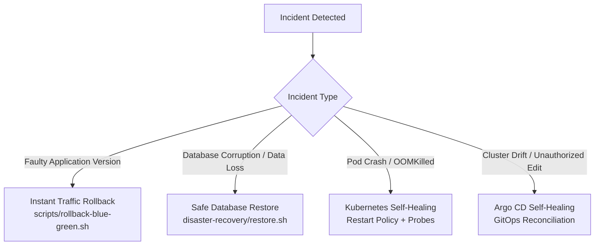

# Enterprise Disaster Recovery & Business Continuity Plan

This plan outlines the recovery strategies, operational targets, and step-by-step procedures to maintain service continuity for **Enterprise TaskFlow**.

---

## 1. Disaster Recovery Metrics & Targets

| Metric | Target | Definition | Implementation in EDDT |
|--------|--------|------------|------------------------|
| **RPO** (Recovery Point Objective) | **< 1 hour** | Maximum acceptable data loss period | Automated database backups scheduled every hour via Cron / Kubernetes CronJob |
| **RTO** (Recovery Time Objective) | **< 15 minutes** | Maximum allowable downtime until service is restored | Point-in-time restore scripts (`restore.sh`) & instant rollback (`rollback-blue-green.sh`) |
| **MTTR** (Mean Time to Recover) | **< 10 minutes** | Average time to diagnose, mitigate, and recover | Pre-scripted runbooks with automated integrity checks |

---

## 2. Failure Scenarios & Mitigation Matrix



### Scenario 1: Faulty Application Version Deployed
- **Impact**: Increased 5xx error rate or broken business functionality.
- **Remediation**: Execute instant Blue-Green traffic switch to previous slot.
- **RTO**: **< 10 seconds**.
- **Action**:
  ```bash
  ./scripts/rollback-blue-green.sh
  ```

### Scenario 2: Database File Corruption or Accidental Data Deletion
- **Impact**: Application returns 503 on `/ready` or queries fail.
- **Remediation**: Restore latest verified backup using [`restore.sh`](restore.sh).
- **RTO**: **< 3 minutes**.
- **Action**:
  ```bash
  ./disaster-recovery/restore.sh
  ```

### Scenario 3: Pod Crashing / Node Failure
- **Impact**: Pod terminates unexpectedly.
- **Remediation**: Kubernetes native controller manager restarts pod on healthy node (replicas: 3 ensures zero customer downtime).
- **RTO**: **0 downtime** (buffered by surviving replicas).

### Scenario 4: Configuration Drift / Tampering
- **Impact**: Manifests altered out-of-band on cluster.
- **Remediation**: Argo CD detects drift and forces alignment to Git source of truth.
- **RTO**: **< 3 minutes** (Argo CD sync interval).

---

## 3. Backup Schedule & Lifecycle Management

- **Frequency**:
  - Production: Hourly snapshot via Cron / Job.
  - Pre-deployment: Mandatory manual snapshot before any schema migration.
- **Integrity Verification**:
  - Every backup is tested with `PRAGMA integrity_check`.
  - Cryptographic hash stored in `.sha256` file to detect bitrot.
- **Retention Policy**:
  - Rolling 7-day retention locally.
  - Offsite archive to cloud object storage (S3/GCS with immutable WORM policy).

---

## 4. Recovery Testing Drills

A disaster recovery plan is merely a hypothesis until tested.
- **Frequency**: Monthly tabletop exercise and quarterly live failover drill in Staging.
- **Verification Criteria**:
  1. Restore executes without manual script modification.
  2. Database passes `PRAGMA integrity_check`.
  3. Pre-restore snapshot is verified created before overwriting.
  4. Application `/ready` endpoint reports `200 OK` and `{ "ready": true }`.
