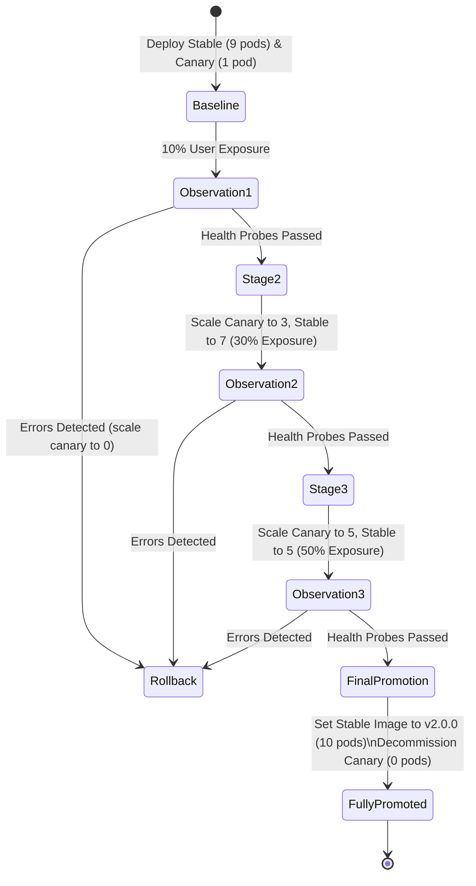

# Comprehensive Deployment Strategies & Enterprise Comparison

This document provides an engineering analysis of the advanced deployment strategies implemented in the **Enterprise DevOps Deployment Toolkit (EDDT)**: **Blue-Green Deployment**, **Canary Deployment**, and **GitOps Continuous Delivery**.

---

## 1. Master Strategy Comparison Matrix

| Evaluation Dimension | Blue-Green Deployment | Canary Deployment | GitOps Continuous Delivery |
|:---------------------|:----------------------|:------------------|:---------------------------|
| **Core Architecture** | Two identical, isolated environments (Blue=Live, Green=Staging) switched via Service selector. | Co-existing fleets behind a single service with traffic divided proportionally across replicas. | Git repository acts as the authoritative source of truth, continuously synced by an in-cluster agent. |
| **Downtime** | **Zero downtime**: Cutover is an atomic pointer update in the Kubernetes Service object. | **Zero downtime**: Traffic shifts smoothly across pods via kube-proxy endpoint balancing. | **Zero downtime**: Manages Blue-Green, Canary, or Rolling manifests declaratively. |
| **Rollback Mechanism** | **Instantaneous (< 1 second)**: Patch the Service selector back to `slot: blue`. | **Instantaneous (< 2 seconds)**: Scale Canary deployment down to `0` replicas; scale Stable to `10`. | **Git Revert**: Reverting a commit in Git triggers automatic declarative cluster convergence. |
| **Infrastructure Cost** | **High (+100% capacity)**: Requires double the compute and memory resources during staging cutover. | **Low (+10% capacity)**: Requires only a minimal slice of additional pods during testing. | **Negligible**: Requires only lightweight cluster controllers (Argo CD / Flux). |
| **Blast Radius / Risk** | **All-or-Nothing**: Once switched, 100% of production traffic hits the new version immediately. | **Minimal**: Only a tiny fraction (~10%) of users are exposed to potential defects. | **Audited & Traceable**: Every change is reviewed via Pull Request and cryptographically signed. |
| **Traffic Precision** | Binary (100% Blue or 100% Green). | **Approximate**: Replica ratios approximate percentages; exact splits require an Ingress controller/Mesh. | Dictated by the underlying workload manifests (Kustomize/Helm). |
| **Database Migration Complexity** | **High**: Database schema must maintain strict backwards and forwards compatibility (Expand-Contract). | **High**: Database must concurrently support queries from both v1.0.0 and v2.0.0 pods. | Managed via declarative migration jobs or external operators. |
| **Operational Complexity** | **Low to Medium**: Easy to grasp, test, and script with standard `kubectl` primitives. | **Medium to High**: Requires health validation, metric observation, and progressive rollout scripts. | **Medium**: Requires Git branching discipline and GitOps toolchain familiarity. |
| **Best Enterprise Use Cases** | Mission-critical financial systems, monolithic services, scheduled release windows with strict zero-downtime SLAs. | High-traffic consumer web applications, microservices architectures, continuous experimentation. | Modern cloud-native Kubernetes environments requiring regulatory audit trails and multi-cluster drift control. |

---

## 2. Deep Dive: Blue-Green Deployment

### How It Works in Kubernetes
In Kubernetes, Blue-Green does not require duplicate physical clusters. Instead, two distinct `Deployment` objects are created in the same namespace:
1. `taskflow-blue`: Runs version 1.0.0 with label `slot: blue`.
2. `taskflow-green`: Runs candidate version 2.0.0 with label `slot: green`.

A single Kubernetes `Service` acts as the traffic switchboard:
```yaml
spec:
  selector:
    app: taskflow
    slot: blue   # Points to active environment
```

When version 2.0.0 is deployed into Green, it is tested via a private preview service (`taskflow-preview-service`). Once all automated probes pass, the production service selector is patched:
```bash
kubectl patch service taskflow-service --type='json' \
  -p='[{"op": "replace", "path": "/spec/selector/slot", "value": "green"}]'
```

### Zero-Downtime Mechanics
Because Kubernetes Service endpoints update atomically in the API server and propagate to `kube-proxy` iptables/IPVS chains, active connections finish processing while new TCP handshakes immediately route to Green pods.

---

## 3. Deep Dive: Canary Deployment

### How It Works in Vanilla Kubernetes
Canary deployment allows a small subset of live user traffic to route to the new candidate software to measure performance and error rates under authentic production load.

In the EDDT toolkit:
- `taskflow-stable`: 9 replicas (v1.0.0, label: `app: taskflow`, `track: stable`).
- `taskflow-canary`: 1 replica  (v2.0.0, label: `app: taskflow`, `track: canary`).

The production service matches only `app: taskflow`:
```yaml
spec:
  selector:
    app: taskflow # Blends both Stable and Canary
```

### Important Traffic Limitation Note
> [!IMPORTANT]
> **Kubernetes Replica Ratios Are Approximations:**
> In native Kubernetes without Istio or Linkerd, traffic distribution across endpoints is determined by random/round-robin packet distribution in `kube-proxy`.
> A 9-to-1 pod ratio **approximates** a 10% traffic split over thousands of requests, but does not guarantee exact byte-level or user-session level percentages.
> If an enterprise requires header-based routing (e.g. internal employees only) or exact 1.0% weighting, an Ingress Controller (such as NGINX Ingress with `canary-weight`) or a Service Mesh (such as Istio `VirtualService`) is required.

### Progressive Canary Promotion Workflow


---

## 4. Deep Dive: GitOps Continuous Delivery

### Push-Based CI/CD vs. Pull-Based GitOps

```mermaid
flowchart TD
    subgraph TraditionalPush ["Traditional Push-Based Deployment"]
        Dev1[Developer] --> CI1[Jenkins CI Server]
        CI1 -->|Holds Production Cluster Admin Keys| Cluster1[Kubernetes Cluster]
        note1[Security Risk: CI Server compromise = Cluster compromise]
    end

    subgraph GitOpsPull ["Modern Pull-Based GitOps (EDDT Architecture)"]
        Dev2[Developer] --> Git2[Git Repo (Source of Truth)]
        CI2[Jenkins CI] -->|Pushes Image to Registry & Opens PR| Git2
        Cluster2[Kubernetes Cluster] -->|In-Cluster Argo CD Pulls State| Git2
        note2[Security Win: Cluster never exposes API externally; CI holds no cluster credentials]
    end
```

### Drift Detection and Self-Healing
If a developer executes `kubectl edit` directly on the production cluster, Argo CD detects that the live etcd object does not match the declarative state in Git. Within its sync loop (default: 3 minutes or via webhook), Argo CD automatically overwrites the cluster state back to the version declared in Git, enforcing absolute configuration hygiene.
