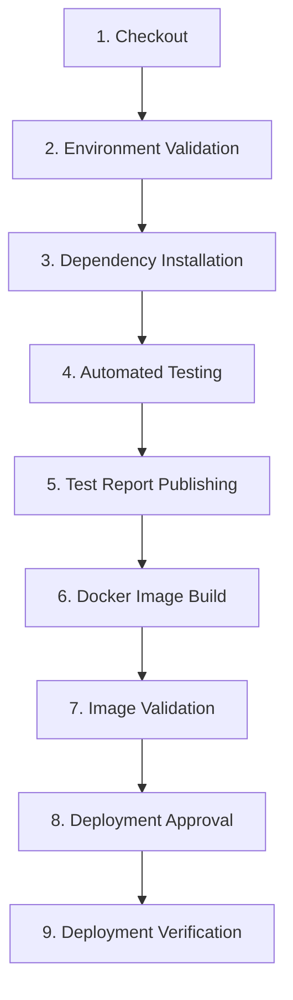

# Jenkins CI/CD Pipeline & Credential Configuration

This guide details how to install, configure, and operate the Jenkins Declarative Pipeline for **Enterprise TaskFlow** without hardcoding sensitive credentials.

---

## 1. Pipeline Overview

The pipeline defined in [`jenkins/Jenkinsfile`](../jenkins/Jenkinsfile) implements 9 distinct stages:



### Stage Details

1. **Checkout**: Retrieves source code from Git with branch and commit metadata logging.
2. **Environment Validation**: Checks versions of `python3`, `pip3`, `docker`, and `git`.
3. **Dependency Installation**: Installs Python dependencies into the Jenkins agent workspace.
4. **Automated Testing**: Runs pytest generating both JUnit XML (`reports/test-results.xml`) and Cobertura XML coverage (`reports/coverage.xml`).
5. **Test Report Publishing**: Publishes JUnit XML test results and archives coverage reports.
6. **Docker Image Build**: Builds a multi-stage Docker image tagged with build number and git commit SHA.
7. **Image Validation**: Verifies labels, entrypoint, and confirms non-root user execution (`1001:appuser`).
8. **Deployment Approval**: Interactive manual gate triggered only on branch `main` with a 15-minute timeout.
9. **Deployment Verification**: Invokes health checks against active service endpoints.

---

## 2. Setting Up Jenkins Locally (Docker / Minikube)

### Running Jenkins in Docker

```bash
# Create persistent volume for Jenkins data
docker volume create jenkins_data

# Run Jenkins with Docker-in-Docker socket access
docker run -d \
  --name jenkins \
  -p 8080:8080 -p 50000:50000 \
  -v jenkins_data:/var/jenkins_home \
  -v /var/run/docker.sock:/var/run/docker.sock \
  jenkins/jenkins:lts-jdk17
```

Get initial admin password:
```bash
docker exec jenkins cat /var/jenkins_home/secrets/initialAdminPassword
```

### Required Jenkins Plugins

Install these plugins via **Manage Jenkins → Plugins → Available Plugins**:
- **Pipeline** (workflow-aggregator)
- **Git**
- **JUnit Plugin** (for test results rendering)
- **Cobertura** or **Coverage** (for code coverage)
- **Docker Pipeline**
- **Credentials Binding Plugin**
- **AnsiColor** (for formatted terminal output)

---

## 3. Secure Credential Configuration

> [!IMPORTANT]
> **Zero Plaintext Credentials in Git:** The `Jenkinsfile` never contains plain passwords, API tokens, or registry keys. All secrets are managed in Jenkins Credentials Store and bound dynamically at runtime.

### Steps to Configure Credentials

1. Navigate to **Manage Jenkins → Credentials → System → Global credentials (unrestricted)**.
2. Click **Add Credentials**.

#### A. Container Registry Credentials
- **Kind**: `Username with password`
- **Scope**: `Global`
- **Username**: `your-registry-username`
- **Password**: `your-token-or-password`
- **ID**: `registry-credentials-id` *(matches the environment block in Jenkinsfile)*
- **Description**: `Container Registry Auth for Enterprise TaskFlow`

#### B. Kubernetes Kubeconfig (for cluster deployments)
- **Kind**: `Secret file`
- **Scope**: `Global`
- **File**: Upload your sanitized `kubeconfig` file
- **ID**: `k8s-kubeconfig`
- **Description**: `Kubernetes Cluster Kubeconfig`

#### C. Application Secret Key
- **Kind**: `Secret text`
- **Scope**: `Global`
- **Secret**: `super-secure-generated-key-string`
- **ID**: `taskflow-secret-key`
- **Description**: `Flask SECRET_KEY runtime environment variable`

---

## 4. Binding Credentials in Pipeline

When ready to enable authenticated push in `Jenkinsfile`, use `withCredentials` or declarative `credentials()` helper:

```groovy
environment {
    REGISTRY_AUTH = credentials('registry-credentials-id')
    SECRET_KEY    = credentials('taskflow-secret-key')
}
```

Jenkins masks all bound credentials in console logs (displaying `****`), preventing accidental leakage.

---

## 5. Running the Pipeline

1. In Jenkins dashboard, select **New Item → Pipeline**.
2. Name the project `Enterprise-TaskFlow-CI`.
3. Under **Pipeline Definition**, select **Pipeline script from SCM**.
4. Choose **Git**, specify your repository URL, and set the script path to `Jenkinsfile`.
5. Click **Build Now** to execute the pipeline.
