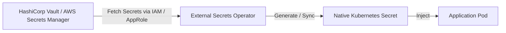

# Enterprise Secret Management in Kubernetes

This document outlines the security architecture, risk analysis, and implementation practices for handling secrets in the **Enterprise DevOps Deployment Toolkit (EDDT)**.

---

## 1. The Core Misconception: Base64 Is NOT Encryption

A critical vulnerability in immature Kubernetes environments is assuming that native Kubernetes `Secret` objects are encrypted.

> [!CAUTION]
> **Base64 is an encoding algorithm, NOT an encryption scheme.**  
> Anyone with read permissions to a secret or access to `kubectl` can decode it instantly:
> ```bash
> # Anyone can decode your secret in one command:
> echo "UExBQ0VIT0xERVJfUEFTU1dPUkQ=" | base64 -d
> ```

---

## 2. Hardening Kubernetes Secrets in Enterprise Environments

To achieve true security with Kubernetes Secrets, enterprises must implement three complementary controls:

### A. Encryption at Rest in etcd

By default, etcd stores cluster data unencrypted on disk. To protect secrets at rest, enable an `EncryptionConfiguration` provider in the Kubernetes API server:

```yaml
apiVersion: apiserver.config.k8s.io/v1
kind: EncryptionConfiguration
resources:
  - resources:
      - secrets
    providers:
      - kms:
          name: aws-kms-or-vault
          endpoint: unix:///var/run/kmsplugin/socket.sock
          cachesize: 1000
      - aescbc:
          keys:
            - name: key1
              secret: <32-byte-base64-encoded-secret>
      - identity: {} # Fallback for unencrypted resources
```

### B. Strict Role-Based Access Control (RBAC)

Restrict which service accounts, users, and pods can read secrets. Never grant wildcard `get,list,watch` on `secrets` across all namespaces:

```yaml
apiVersion: rbac.authorization.k8s.io/v1
kind: Role
metadata:
  namespace: eddt-prod
  name: taskflow-secret-reader
rules:
  - apiGroups: [""]
    resources: ["secrets"]
    resourceNames: ["taskflow-secret"]
    verbs: ["get"] # Least privilege: 'get' specific secret only; disallow 'list' and 'watch'
```

### C. Git Hygiene and Exclusion

All files containing real credentials must be excluded from version control:
- `.gitignore` in this project enforces rules for `*.pem`, `*.key`, `secrets.yaml`, and `*-credentials.yaml`.
- Only sanitized templates (like [`secret-example.yaml`](secret-example.yaml)) containing explicit placeholder strings may be committed.

---

## 3. Injecting Secrets into Pods

### Method 1: Environment Variables (Used in TaskFlow)

Best for lightweight configuration strings (e.g. `SECRET_KEY`):

```yaml
env:
  - name: SECRET_KEY
    valueFrom:
      secretKeyRef:
        name: taskflow-secret
        key: SECRET_KEY
```

*Pros:* Simple, direct integration with standard library `os.getenv()`.  
*Cons:* Visible via `/proc/<pid>/environ` to any process inside the container.

### Method 2: Mounted Secret Volumes (Recommended for TLS Certs & Keys)

Mounts secrets as read-only files in a `tmpfs` (RAM-backed) filesystem:

```yaml
volumeMounts:
  - name: secret-volume
    mountPath: /etc/secrets
    readOnly: true
volumes:
  - name: secret-volume
    secret:
      secretName: taskflow-secret
```

*Pros:* Secrets are never written to disk (stored in RAM only); files update automatically when the secret changes without restarting the pod.

---

## 4. Enterprise Extension: External Secret Management (ESO + Vault)

For mature enterprise deployments, secrets should reside in an external key management system (e.g., **HashiCorp Vault**, **AWS Secrets Manager**, or **Azure Key Vault**) and be synchronized into Kubernetes via the **External Secrets Operator (ESO)**:



### Example: ExternalSecret Manifest

```yaml
apiVersion: external-secrets.io/v1beta1
kind: ExternalSecret
metadata:
  name: taskflow-external-secret
  namespace: eddt-prod
spec:
  refreshInterval: "1h"
  secretStoreRef:
    name: vault-backend
    kind: ClusterSecretStore
  target:
    name: taskflow-secret
    creationPolicy: Owner
  data:
    - secretKey: SECRET_KEY
      remoteRef:
        key: secret/data/taskflow
        property: secret_key
```

### Benefits of External Secrets Operator:
- Zero secrets committed to Git (GitOps friendly).
- Centralized audit logging (who accessed what secret, and when).
- Automated rotation on lease expiry without manual redeployments.
